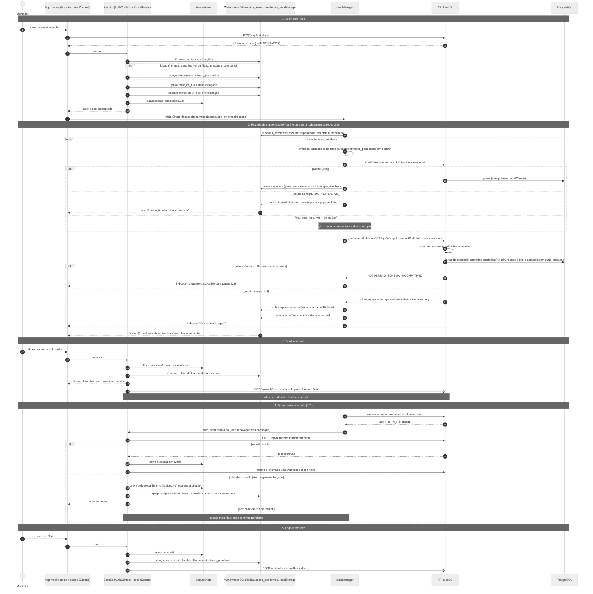

# Decisão de arquitetura: offline-first no aplicativo mobile

> **Nota.** O Documento de Projeto (`Documentacao/DocumentoDeProjeto.pdf`) é um PDF e não pode ser
> editado neste repositório. Este arquivo traz o texto pronto para colar nele. Sugestão de
> encaixe: uma nova subseção **3.6 Arquitetura Offline-first do Aplicativo Mobile** depois de
> "3.5 Diagrama de Estados", e o diagrama de sequência da seção 8 como figura nova em
> "3.2 Diagramas de Sequência". O roteiro de testes de aceitação está em
> [`ROTEIRO-ACEITACAO-OFFLINE-FIRST.md`](./ROTEIRO-ACEITACAO-OFFLINE-FIRST.md).
>
> Origem: épico #105 e sub-issues #106 a #115. O texto descreve o código da branch de integração
> `feat/offline-first-epico-105`, com #106 a #114 entregues.

## 1. Contexto e problema

O Montador trabalha em obras, muitas vezes sem sinal. O aplicativo já gravava ponto, ponto em
atraso e avaria no aparelho antes de enviar, usando uma fila (`acoes_pendentes`) no WatermelonDB.
Uma análise de arquitetura encontrou lacunas que impediam o funcionamento offline de ponta a ponta:

| Lacuna | Efeito em campo |
| --- | --- |
| O boot chamava `GET /api/auth/me`; sem rede, o app ia para o Login (que também exige rede). | Quem fechava o app numa obra sem sinal não conseguia mais bater ponto. |
| O access token dura 1 h e só era renovado no boot; o envio tratava **qualquer** 4xx, inclusive 401, como recusa de regra. | Depois de mais de 1 h sem sinal, a marcação feita offline era apagada da fila ao voltar a rede. |
| A sincronização só era ligada pela tela Jornada. | Avaria registrada na aba Avarias só subia quando o montador voltava à Jornada. |
| Pedidos, peças, tipos de avaria, avarias e atestados não tinham cópia local. | Formulário de avaria e lista de atestados não abriam sem rede. |
| O WatermelonDB era usado sem o protocolo de sincronização dele (download feito à mão, sem exclusões). | Obra desalocada no servidor continuava aparecendo no aparelho. |
| Fotos de avaria iam para a fila como base64 dentro do `payload`. | Linhas de vários MB no SQLite. |

## 2. Decisão

Manter o **WatermelonDB** e adotar um modelo **híbrido**: o download usa o protocolo de pull do
WatermelonDB e o envio continua pela fila de comandos.

**Download (servidor → aparelho).** O `synchronize()` do WatermelonDB
(`Codigo/apps/mobile/src/sincronizacao/syncManager.ts`) chama, em `pullChanges`, o endpoint
`GET /api/sync/pull?lastPulledAt=<ms>&schemaVersion=<n>`, que devolve só o que mudou desde a
última sincronização. Parâmetros:

- `sendCreatedAsUpdated: true`: o servidor manda tudo em `updated` e deixa `created` vazio, sem
  precisar saber o que o aparelho já tem;
- `pushChanges` vazio: as tabelas da réplica nunca recebem escrita local;
- `migrationsEnabledAtVersion: 2`. Se o WatermelonDB pedir um pull com migração de schema, o app
  falha de propósito (`pullChanges.ts`): o contrato não tem esse parâmetro, e ignorá-lo deixaria a
  réplica incompleta. Uma futura v4 do schema local precisa tratar esse caso.

As tabelas locais da réplica são **espelho puro do servidor**: id local = id do servidor (string),
colunas em `snake_case` iguais às do contrato e escrita feita só pelo pull. O contrato está em
`Codigo/packages/shared/src/sync/` (`tipos.ts`, `janelas.ts`, `fixture.ts`).

**Envio (aparelho → servidor).** Continua a **fila de comandos** `acoes_pendentes`, com os tipos
`checkin`, `checkout`, `ponto em atraso`, `avaria` e `atestado`. Cada ação leva um `idCliente`
(UUID gerado no aparelho) e a API é idempotente por ele: reenviar a mesma ação não duplica
registro. A fila é **drenada antes do pull**, em ordem de criação, para que o pull já traga o
resultado do que acabou de subir.

**Telas = réplica + fila sobreposta.** As telas leem a réplica e mostram por cima as ações ainda
na fila: check-in e check-out pendentes viram jornada exibível; avarias e atestados pendentes
aparecem com o selo "Aguardando envio". Uma ação sai da sobreposição quando a réplica já tem o
registro com o mesmo `idCliente` (`checkin_id_cliente`, `checkout_id_cliente`, `id_cliente`).

**Por que o push genérico do WatermelonDB não serve.** O `pushChanges` do WatermelonDB envia
diferenças de linhas e espera aceitação em bloco. A marcação de ponto é um **comando validado pelo
servidor**: raio de tolerância de 200 m da obra (`RAIO_TOLERANCIA_PONTO_METROS`, conferido também
no aparelho com as coordenadas da réplica), sequência entrada/saída, obra atribuída ao montador e
as regras de registro de ponto da Portaria MTP 671/2021 (o servidor gera o AFD a partir do que ele
mesmo validou). O servidor precisa poder **recusar ação por ação**, com motivo, sem invalidar as
demais, e o registro oficial do ponto não pode ser uma linha editada no aparelho. A fila de
comandos tem essa semântica: cada ação é aceita, recusada (descartada com mensagem ao montador) ou
fica pendente.

**Cópia local com escopo.** A réplica contém só os dados de que o montador logado precisa em campo,
não o banco inteiro, e é apagada no logout.

**Estado de app** (sessão, status da sincronização, obra escolhida, rascunho de avaria) fica em
stores Zustand (`Codigo/apps/mobile/src/estado/`). Dados de domínio ficam só no WatermelonDB.

## 3. Escopo da réplica

O escopo vem sempre do token (`usuario.id`), nunca da query: o endpoint não tem como devolver dados
de outro montador (`@Roles(Perfil.MONTADOR)`, coberto por teste e2e). Janelas definidas em
`packages/shared/src/sync/janelas.ts`, usadas pela API e pelo app.

| Tabela local | Conteúdo | Janela no primeiro pull |
| --- | --- | --- |
| `jornadas` | Jornadas do montador, com `pedido_id`, `checkin_id_cliente`, `checkout_id_cliente`, `lancado_em_atraso` | 30 dias, por `checkin_at` |
| `banco_horas` | Saldos do montador por (`mes`, `ano`); o mês corrente é recalculado pelo servidor a cada pull | mês atual e os 2 anteriores |
| `pedidos` | Pedidos atribuídos ao montador (`pedido_montador`), com cliente desnormalizado: nome, endereço, cidade, UF, latitude, longitude | todos os atribuídos |
| `ambientes`, `pecas` | Dos pedidos acima (o formulário de avaria escolhe a peça) | todos os dos pedidos atribuídos |
| `tipos_avaria` | Catálogo global | todos |
| `avarias` | Registradas pelo montador, sem fotos, com rótulos de peça, ambiente e pedido | 30 dias, por data de criação |
| `atestados` | Do montador, sem fotos | 90 dias, por data de criação |

As janelas valem **só no primeiro pull** (sem `lastPulledAt`, ou `lastPulledAt = 0`). No pull
incremental entra qualquer linha do escopo alterada depois de `lastPulledAt`, mesmo que antiga (por
exemplo, uma avaria de 45 dias analisada hoje), para que o aparelho não fique com status
desatualizado.

Banco de horas de um mês fora da réplica é buscado online e mostrado só na tela, sem gravar na
réplica. Sem rede, a tela mostra "Sem dados offline para este mês".

Fotos de avaria e atestado não são replicadas: continuam no Supabase Storage, acessadas online por
URL assinada.

## 4. Divisão de estado no aparelho

| Tipo de estado | Onde fica |
| --- | --- |
| Dados de domínio (jornadas, pedidos, peças, avarias, atestados, banco de horas) | WatermelonDB, lido com `observe()`; nunca copiado para os stores |
| Fila de ações (`acoes_pendentes`) e dono da fila (`dono_da_fila`) | WatermelonDB (a fila em tabela; o dono no `localStorage` do banco) |
| Fotos ainda não enviadas | Arquivos na pasta `fotos_pendentes` do diretório de documentos do app (`expo-file-system`); a fila e o rascunho guardam só o nome do arquivo |
| Tokens e usuário em cache (`mc.sessao.v2`); marcador de dono após expiração forçada (`mc.fila.dono.v1`, só o id) | `expo-secure-store` (Keychain/Keystore) |
| Sessão: usuário logado e "restaurando" (`sessaoStore`) | Zustand **só em memória**; o usuário é restaurado do SecureStore no boot |
| Status da sincronização: `online`, `sincronizando`, `pendentes`, `ultimaSincronizacaoEm`, `ultimoErro`, avisos de recusa (`sincronizacaoStore`) | Zustand; persiste só `ultimaSincronizacaoEm`, chave `mc.sincronizacao.v1` |
| Obra escolhida para o ponto e rascunho de avaria com nomes das fotos (`uiStore`) | Zustand; persiste tudo, chave `mc.ui.v1` |
| Estado passageiro de tela (modal aberto, formulário de atestado) | `useState` |

O `persist` dos stores grava no `localStorage` do próprio WatermelonDB
(`estado/armazenamentoDoBanco.ts`). Assim, o wipe do banco no logout e na troca de usuário apaga
essas chaves junto, sem lista paralela. Os stores usam `skipHydration`: o `AuthContext` só lê o
disco depois de decidir se o aparelho é do usuário que autenticou, para nunca reidratar o rascunho
de outro montador. O syncManager roda fora do React e publica o status por `setState`.

O formulário de atestado não tem rascunho persistido: datas, observação e foto são dado de saúde, e
o `localStorage` do banco não é criptografado. As fotos anexadas e não enviadas são apagadas quando
o formulário fecha.

O **indicador de sincronização** fica acima da barra de abas, igual em todas as abas
(`sincronizacao/IndicadorDeSincronizacao.tsx`). Textos, em ordem de prioridade: "Atualize o
aplicativo para sincronizar", "Sincronizando…", "Sem conexão", "Falha ao sincronizar", "Servidor
sem resposta", "N pendentes", "Sincronizado há X" e "Aguardando a primeira sincronização". Os
estados que não são de sucesso acrescentam "· N pendentes" quando há fila.

### Matriz de persistência e limpeza

| Dado | Fechar e reabrir o app | Expiração forçada (refresh recusado) | Logout explícito | Login de outro usuário |
| --- | --- | --- | --- | --- |
| Réplica (tabelas do pull) e `lastPulledAt` | mantém | apaga | apaga | apaga |
| Fila `acoes_pendentes` | mantém | **mantém**, marcada com o dono | apaga | apaga |
| Fotos em `fotos_pendentes` (da fila e do rascunho) | mantém | mantém | apaga | apaga |
| Obra escolhida e rascunho de avaria (`mc.ui.v1`) | mantém | mantém (mesmo dono da fila) | apaga | apaga |
| Status da sincronização (`mc.sincronizacao.v1`) | mantém `ultimaSincronizacaoEm` | apaga | apaga | apaga |
| Sessão no SecureStore (`mc.sessao.v2`) | mantém | apaga | apaga | substituída |
| Marcador de dono (`mc.fila.dono.v1`) | sem mudança | grava | apaga | apaga |

No login seguinte à expiração forçada, se entrar o **mesmo** montador, fila, fotos, obra e rascunho
voltam e a fila sobe com o token novo. Se entrar **outro**, tudo é apagado antes de liberar o token.

## 5. Sessão resiliente

Regras implementadas em `Codigo/apps/mobile/src/auth/` (`AuthContext.tsx`, `tokenSessao.ts`,
`armazenamentoSessao.ts`, `destinoDaFila.ts`) e `src/sincronizacao/`:

1. **Boot offline.** Com sessão salva, o app entra na hora com o usuário em cache, sem esperar a
   rede. `GET /api/auth/me` é revalidado em segundo plano; falha de rede não derruba a sessão.
   Perfil diferente de MONTADOR (em cache ou na revalidação) encerra a sessão e apaga tudo.
2. **Renovação de token durante a sessão.** Uma fonte única de token (`tokenSessao.ts`) atende
   todos os clientes HTTP e o syncManager. Em 401, renova uma vez (renovação compartilhada entre
   chamadas simultâneas, porque o refresh token é rotativo) e repete a chamada uma vez.
3. **401 nunca descarta a fila.** Para a fila, 401, 408, 429, 5xx e falha de rede não são recusa:
   a ação continua `pendente` e a drenagem para. Só 4xx de regra de negócio (400, 403, 409, 422…)
   descarta a ação.
4. **Dono da fila, com falha fechada.** No login e no boot, antes de liberar o token, o app compara
   o usuário com o dono da fila. Detalhes na seção 7.
5. **Ações não cruzam sessões.** Um contador de geração da sessão é lido antes de cada drenagem e de
   cada pull e conferido antes de enviar a próxima ação e antes de aplicar o pull. Se a sessão
   trocou no meio, nada é enviado nem gravado: uma ação de um montador nunca sai com o token de
   outro, e o pull de uma sessão encerrada não chega à réplica.
6. **Logout explícito apaga tudo** (ver a matriz da seção 4). Garante a troca de usuário sem
   resíduo. Ações ainda não enviadas são perdidas, por decisão: o logout é um pedido explícito.
7. **Expiração forçada preserva a fila.** Se o servidor recusar o refresh token (por exemplo, dias
   sem sinal), o app grava o dono da fila, apaga a sessão e a réplica, mantém `acoes_pendentes`,
   as fotos e o estado de UI, e volta ao Login.

## 6. Protocolo de sincronização

**Servidor** (`Codigo/apps/api/src/sync/`, #109 e #110):

- **Timestamp antes das consultas.** O servidor lê o relógio (`timestamp` da resposta) antes de
  qualquer consulta. No incremental filtra `updated_at > lastPulledAt - 5 min`
  (`SYNC_MARGEM_SEGURANCA_MS`), para não perder linhas gravadas durante a consulta anterior. Linha
  repetida não tem custo: o app faz upsert.
- **Colunas de alteração.** A migração Prisma `20261017120000_suporte_pull_incremental`
  acrescentou `updated_at` em `ambiente`, `tipo_avaria`, `banco_horas` e `atestado`, `created_at`
  em `pedido_montador` (data da atribuição) e índices por usuário e data.
- **Pedidos visíveis.** Um pedido entra no incremental se o pedido, o cliente ou a atribuição ao
  montador mudou depois de `lastPulledAt`. Ambientes e peças entram pela própria alteração ou pela
  atribuição recente do pedido.
- **Exclusões (tombstones).** Tabela `sync_exclusao` (`entidade`, `registro_id`, `usuario_id`
  opcional, `excluido_em`). A desalocação de um montador grava, na mesma transação, a exclusão do
  pedido e dos seus ambientes e peças só para quem saiu. O pull incremental devolve essas linhas em
  `deleted`. Um id que voltou a ser atribuído (está em `updated`) é retirado de `deleted`.
- **Versão do contrato.** O app envia `schemaVersion` (`SYNC_SCHEMA_VERSION = 2`). Versão
  diferente responde **426** com `{ codigo: 'VERSAO_SCHEMA_INCOMPATIVEL' }`.
- **Erros do endpoint.** 401 sem token ou token inválido (`TOKEN_EXPIRADO`); 403 para GESTOR, RH e
  DEPOSITO; 400 para query inválida.

**Aparelho** (`Codigo/apps/mobile/src/sincronizacao/`, #107, #112, #113):

- **Gatilhos.** A sincronização é ligada uma vez no app autenticado (acima das abas): ao entrar, na
  volta da conexão (NetInfo) e quando o app volta ao primeiro plano. Desliga no logout.
- **Repetição.** Um gatilho que chega com uma rodada da mesma sessão em curso não se perde: marca a
  rodada para repetir assim que terminar.
- **Status `enviada`.** Check-in, check-out, avaria e atestado aceitos pelo servidor não saem da
  fila na hora: ficam `enviada` e continuam sobrepostos até o pull trazer o registro. Depois de um
  pull bem-sucedido, as ações `enviada` que já existiam antes dele são apagadas. Sem isso, um pull
  que falhasse logo depois do envio faria o ponto sumir da tela e o montador bater de novo. O ponto
  em atraso não tem registro para sobrepor e sai da fila ao ser aceito.
- **Recusas.** A ação recusada vira `descartada` com mensagem, e a tela mostra o aviso "Uma ação
  não foi sincronizada" (botão "Dispensar") nas telas Jornada, Avarias e Atestados. Avaria e
  atestado levam o texto do servidor ("Avaria recusada: …", "Atestado recusado: …"); ponto leva o
  código ("Ação recusada: CODIGO."). Recusa no envio imediato aparece no próprio formulário, com o
  texto do servidor e o aviso de que as fotos foram descartadas.
- **426.** Classificado como erro de versão: o indicador mostra "Atualize o aplicativo para
  sincronizar" e a Jornada mostra o alerta "Atualize o aplicativo". O ponto continua disponível e
  as marcações ficam guardadas no aparelho.
- **Fotos.** Ao anexar, a foto é copiada para `fotos_pendentes` e só o nome do arquivo vai para o
  `payload` ou para o rascunho (caminho absoluto quebraria no iOS, onde o prefixo do container muda
  a cada atualização). O base64 só é montado na hora do envio. Os arquivos são apagados depois do
  envio confirmado ou da recusa, e a pasta inteira no logout e na troca de usuário. Foto que sumiu
  do aparelho: a avaria sobe com as que restam; o atestado sem nenhuma foto é descartado com
  mensagem própria, sem ir ao servidor.
- **Schema local v3.** A v3 tirou de `jornadas` o estado otimista (`remote_id`, `id_cliente_checkin`,
  `id_cliente_checkout`; a coluna física fica órfã, porque o WatermelonDB não remove coluna). A
  migração v2 → v3 apaga as linhas de `jornadas` e `banco_horas` (vieram do download antigo, com id
  local aleatório, e duplicariam no primeiro pull) e as chaves legadas `obras_do_montador` e
  `obra_da_jornada_aberta` do `localStorage` (cópia do cliente da obra). `acoes_pendentes` não é
  tocada. Toda mudança de schema local exige passo de migração e teste de que a fila sobrevive:
  subir a versão sem migração faria o WatermelonDB recriar o banco e apagar a fila.

## 7. Decisões tomadas durante a execução

| Decisão | Motivo |
| --- | --- |
| **Dono da fila com falha fechada.** No login e no boot: mesmo dono, a fila fica; outro dono, dono ilegível ou fila com ações sem dono conhecido, o banco inteiro e as fotos são apagados. Se não conseguir apagar ou gravar o novo dono, o login falha. Vale o dono gravado no banco; o marcador do SecureStore só cobre a janela entre a expiração forçada e o próximo login. | Uma ação de um montador nunca pode subir com o token de outro. Custo aceito: uma fila anterior a esta versão, sem dono, é apagada uma vez no primeiro login após a atualização. |
| **Timeouts separados:** 5 s para revalidar `/auth/me`, 20 s para `/auth/refresh`. | A revalidação não pode segurar o boot. O refresh é rotativo: abortado cedo, o servidor pode ter trocado o token sem o app saber, e a sessão cairia à toa. |
| **Expiração forçada preserva a fila** (decisão de produto, aprovada no épico). | A issue original mandava limpar o banco; isso perderia marcações de ponto de quem ficou dias sem sinal. |
| **Janelas de histórico só no primeiro pull.** | Aplicadas também no incremental, a atualização de uma linha antiga (avaria de 45 dias analisada hoje) nunca chegaria ao aparelho. |
| **Rótulos de peça, ambiente e pedido copiados na linha da avaria** (`peca_descricao`, `ambiente_nome`, `numero_pedido`). | A avaria pode ser de peça de um pedido já desalocado; sem a cópia, a lista ficaria com referência órfã. Os rótulos só mudam quando a própria avaria muda. |
| **408 e 429 também não descartam** (além de 401). | O servidor não chegou a decidir; descartar perderia a ação. |
| **Status `enviada` na fila** para ponto, avaria e atestado aceitos. | Evita o registro sumir da tela entre o envio e o pull. |
| **`persist` no `localStorage` do WatermelonDB, sem MMKV.** | Ver seção 10. |

## 8. Diagrama de sequência

Também salvo em `Artefatos/Diagramas/sequencia-sincronizacao-offline-first.mmd`.

Legenda para a figura: "Figura N. Diagrama de Sequência da Sincronização Offline-first do
Aplicativo Mobile."

## 9. LGPD

- **Minimização.** O contrato do pull não traz CPF, e-mail nem telefone de ninguém, nem dados de
  terceiros como quem analisou a avaria ou validou o atestado. Do cliente vão nome, endereço e
  coordenadas, necessários para o montador chegar à obra e para a validação do raio do ponto.
- **Escopo.** O aparelho guarda só os dados do montador logado, filtrados pelo token no servidor.
- **Fotos fora da réplica.** Fotos de avaria e atestado (atestado é dado de saúde) não são
  replicadas; ficam em bucket privado, acessadas por URL assinada. Fotos ainda não enviadas ficam
  como arquivo na pasta privada do app só até o envio, a recusa ou o logout.
- **Armazenamento.** Tokens e o usuário em cache (id, nome, e-mail, perfil, ativo) ficam só no
  Keychain/Keystore; o store de sessão não é persistido. O `localStorage` do banco, que não é
  criptografado, guarda apenas estado não pessoal: obra escolhida, rascunho de avaria (descrição e
  nomes de arquivo), instante da última sincronização e o id do dono da fila. Atestado não tem
  rascunho persistido.
- **Eliminação.** Logout e troca de usuário apagam réplica, fila, fotos, estados persistidos e
  sessão. A migração v3 apagou as cópias antigas de obra (nome e endereço do cliente) que o app
  guardava no `localStorage`. A expiração forçada apaga réplica e sessão e mantém só o que é do
  próprio montador e ainda precisa chegar ao servidor.

## 10. Alternativas consideradas

| Alternativa | Por que não |
| --- | --- |
| `synchronize()` completo do WatermelonDB (pull e push genéricos) | O push envia diferenças de linhas e não permite recusa ação a ação com motivo; o ponto precisa ser comando validado pelo servidor (Portaria 671). |
| Manter o download feito à mão (`puxarJornadas`, `puxarBancoHoras`) | Sem pull incremental e sem exclusões: obra desalocada não sai do aparelho, e cada tabela nova exigiria código próprio de download. |
| Replicar o banco inteiro | Volume e exposição de dados sem necessidade (LGPD). O escopo do montador logado basta para o trabalho em campo. |
| Soft delete (`deletado_em`) em todas as tabelas replicadas | Exigiria filtrar `deletado_em` em todas as consultas existentes da API. A tabela `sync_exclusao` é menos invasiva. |
| Estado otimista gravado na réplica (jornada "falsa" com `remote_id` nulo) | Duplicava jornadas e exigia reconciliação. Substituído pela fila sobreposta à réplica. |
| Recriar a tabela `jornadas` por SQL na v3 para remover colunas | Arriscado ao lado de `acoes_pendentes` e não testável no banco de teste; as colunas ficam órfãs, sem efeito. |
| Estado global só com Context do React | Não persiste entre reinícios (obra escolhida, rascunho com fotos) e o syncManager roda fora do React. |
| `react-native-mmkv` como storage do Zustand (sugestão da issue #114) | **Não adotado**: é dependência nativa e exigiria rebuild e conferência de compatibilidade com o Expo SDK 57 e a New Architecture. O `localStorage` do WatermelonDB não traz dependência nova e é apagado junto no wipe. Fica como alternativa futura, se a leitura assíncrona no boot mostrar problema; nesse caso, com a chave de criptografia do MMKV guardada no SecureStore. |
| Trocar WatermelonDB por `expo-sqlite` + Drizzle agora | A fila e o schema local já estavam em WatermelonDB e funcionam com o Expo SDK atual. Fica como critério de saída (abaixo). |

## 11. Critério de saída registrado

Se o build quebrar por causa do WatermelonDB (`@nozbe/watermelondb`) ou do plugin
`@lovesworking/watermelondb-expo-plugin-sdk-52-plus` numa atualização de Expo ou React Native,
**reavaliar a migração para `expo-sqlite` + Drizzle**. Versões no momento da decisão: Expo SDK 57,
React Native 0.86, WatermelonDB 0.28 (com patch local de caminho curto do módulo nativo, ver
`Codigo/apps/mobile/BUILD-APK.md`, seção 4.3).

Como o contrato do pull (`packages/shared/src/sync/`) e a fila de comandos não dependem do
WatermelonDB, a migração trocaria só a camada de banco local do app; a API não muda.

## 12. Limitações conhecidas

- **Lacuna logo após a atualização.** A migração v2 → v3 apaga `jornadas` e `banco_horas` locais.
  Até o primeiro pull com rede, o aparelho atualizado não mostra histórico nem banco de horas
  offline (a fila é preservada e o ponto continua funcionando).
- `banco_horas` é um registro gravado quando alguém calcula o saldo. O pull recalcula no servidor
  o mês corrente do montador logado (só grava se o valor mudou, para não reenviar a linha sem
  novidade), então esse mês sempre chega atualizado. Os meses anteriores da janela só estão na
  réplica se já tiveram cálculo prévio (consulta do montador ou painel do RH) e não são
  recalculados no pull. Se o recálculo falhar, o pull segue com o saldo já gravado.
- Todos os pedidos atribuídos ao montador entram no primeiro pull, inclusive os já entregues (não
  há janela para pedidos).
- A API aceita marcação de ponto do dia corrente ou do dia anterior (`REGISTRO_FORA_DA_JANELA`).
  Uma marcação que ficar mais tempo que isso na fila é recusada e deve ser lançada como ponto em
  atraso.
- Quem tinha sessão no formato antigo (`mc.sessao.v1`) precisa entrar de novo uma vez.
- Se o app morrer entre o envio aceito e a remoção da foto, o arquivo fica órfão até o próximo
  logout.
- Validado só com testes automatizados (Jest com LokiJS e mocks); o SQL da migração v3 e a cópia de
  fotos pelo `expo-file-system` precisam ser conferidos em aparelho (roteiro, seção "Checagens em
  aparelho").
