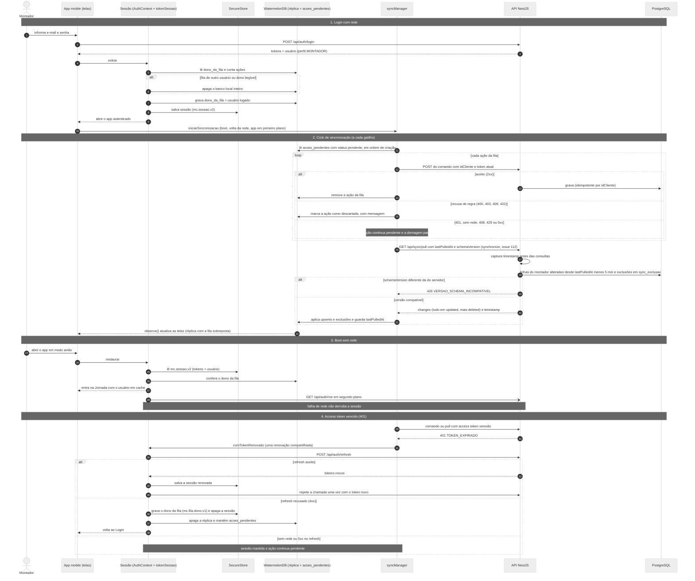

# Decisão de arquitetura: offline-first no aplicativo mobile

> **Nota.** O Documento de Projeto (`Documentacao/DocumentoDeProjeto.pdf`) é um PDF e não pode ser
> editado neste repositório. Este arquivo traz o texto pronto para colar nele. Sugestão de
> encaixe: uma nova subseção **3.6 Arquitetura Offline-first do Aplicativo Mobile** depois de
> "3.5 Diagrama de Estados", e o diagrama de sequência da seção 7 como figura nova em
> "3.2 Diagramas de Sequência". O roteiro de testes de aceitação está em
> [`ROTEIRO-ACEITACAO-OFFLINE-FIRST.md`](./ROTEIRO-ACEITACAO-OFFLINE-FIRST.md).
>
> Origem: épico #105 e sub-issues #106 a #115. Os pontos marcados com "conforme a issue #N (em
> implementação)" descrevem o que a issue especifica; ainda não estão na branch de integração
> `feat/offline-first-epico-105` quando este texto foi escrito.

## 1. Contexto e problema

O Montador trabalha em obras, muitas vezes sem sinal. O aplicativo já gravava ponto, ponto em
atraso e avaria no aparelho antes de enviar, usando uma fila (`acoes_pendentes`) no WatermelonDB.
Uma análise de arquitetura encontrou lacunas que impediam o funcionamento offline de ponta a ponta:

| Lacuna | Efeito em campo |
| --- | --- |
| O boot chamava `GET /api/auth/me`; sem rede, o app ia para o Login (que também exige rede). | Quem fechava o app numa obra sem sinal não conseguia mais bater ponto. |
| O access token dura 1 h e só era renovado no boot; o envio tratava **qualquer** 4xx, inclusive 401, como recusa de regra. | Depois de mais de 1 h sem sinal, a marcação feita offline era apagada da fila ao voltar a rede. |
| A sincronização só era ligada pela tela Jornada. | Avaria registrada na aba Avarias só subia quando o montador voltava à Jornada. |
| Pedidos, peças, tipos de avaria, avarias e atestados não tinham cópia local. | Formulário de avaria e lista de atestados não abriam sem rede. |
| O WatermelonDB era usado sem o protocolo de sincronização dele (download feito à mão, sem exclusões). | Obra desalocada no servidor continuava aparecendo no aparelho. |

## 2. Decisão

Manter o **WatermelonDB** e adotar um modelo **híbrido**: o download usa o protocolo de pull do
WatermelonDB e o envio continua pela fila de comandos.

**Download (servidor → aparelho).** O `synchronize()` do WatermelonDB chama, em `pullChanges`, o
endpoint `GET /api/sync/pull?lastPulledAt=<ms>&schemaVersion=<n>`, que devolve só o que mudou desde
a última sincronização (conforme a issue #112, em implementação, para o lado do app; o endpoint já
existe, #110). Parâmetros do cliente:

- `sendCreatedAsUpdated: true`: o servidor manda tudo em `updated` e deixa `created` vazio, sem
  precisar saber o que o aparelho já tem;
- `pushChanges` vazio: as tabelas da réplica nunca recebem escrita local;
- `migrationsEnabledAtVersion: 2`: a réplica nasce no schema local v2.

As tabelas locais da réplica são **espelho puro do servidor**: id local = id do servidor (string),
colunas em `snake_case` iguais às do contrato e escrita feita só pelo pull. O contrato está em
`Codigo/packages/shared/src/sync/` (`tipos.ts`, `janelas.ts`, `fixture.ts`).

**Envio (aparelho → servidor).** Continua a **fila de comandos** `acoes_pendentes` (check-in,
check-out, ponto em atraso e avaria; atestado conforme a issue #113, em implementação). Cada ação
leva um `idCliente` (UUID gerado no aparelho) e a API é idempotente por ele: reenviar a mesma ação
não duplica registro. A fila é **drenada antes do pull**, para que o pull já traga o resultado do
que acabou de subir.

**Por que o push genérico do WatermelonDB não serve.** O `pushChanges` do WatermelonDB envia
diferenças de linhas e espera aceitação em bloco. A marcação de ponto é um **comando validado pelo
servidor**: raio de tolerância de 200 m da obra (`RAIO_TOLERANCIA_PONTO_METROS`), sequência
entrada/saída, obra atribuída ao montador e as regras de registro de ponto da Portaria MTP
671/2021 (o servidor gera o AFD a partir do que ele mesmo validou). O servidor precisa poder
**recusar ação por ação**, com motivo, sem invalidar as demais, e o registro oficial do ponto não
pode ser uma linha editada no aparelho. A fila de comandos tem exatamente essa semântica: cada ação
é aceita, recusada (descartada com mensagem ao montador) ou fica pendente.

**Cópia local com escopo.** A réplica contém só os dados de que o montador logado precisa em campo,
não o banco inteiro, e é apagada no logout.

**Estado de app** (sessão, status da sincronização, obra escolhida, rascunhos) vai para Zustand com
persistência (conforme a issue #114, em implementação). Dados de domínio ficam só no WatermelonDB.

## 3. Escopo da réplica

O escopo vem sempre do token (`usuario.id`), nunca da query: o endpoint não tem como devolver dados
de outro montador (`@Roles(Perfil.MONTADOR)`, coberto por teste e2e). Janelas definidas em
`packages/shared/src/sync/janelas.ts`, usadas pela API e pelo app.

| Tabela local | Conteúdo | Janela no primeiro pull |
| --- | --- | --- |
| `jornadas` | Jornadas do montador, com `pedido_id`, `checkin_id_cliente`, `checkout_id_cliente`, `lancado_em_atraso` | 30 dias, por `checkin_at` |
| `banco_horas` | Saldos do montador por (`mes`, `ano`) | mês atual e os 2 anteriores |
| `pedidos` | Pedidos atribuídos ao montador (`pedido_montador`), com cliente desnormalizado: nome, endereço, cidade, UF, latitude, longitude | todos os atribuídos |
| `ambientes`, `pecas` | Dos pedidos acima (o formulário de avaria escolhe a peça) | todos os dos pedidos atribuídos |
| `tipos_avaria` | Catálogo global | todos |
| `avarias` | Registradas pelo montador, sem fotos, com rótulos de peça, ambiente e pedido | 30 dias, por data de criação |
| `atestados` | Do montador, sem fotos | 90 dias, por data de criação |

As janelas valem **só no primeiro pull** (sem `lastPulledAt`, ou `lastPulledAt = 0`). No pull
incremental entra qualquer linha do escopo alterada depois de `lastPulledAt`, mesmo que antiga (por
exemplo, uma avaria de 45 dias analisada hoje), para que o aparelho não fique com status
desatualizado.

Fotos de avaria e atestado não são replicadas: continuam no Supabase Storage, acessadas online por
URL assinada.

## 4. Divisão de estado no aparelho

| Tipo de estado | Onde fica | Situação |
| --- | --- | --- |
| Dados de domínio (jornadas, pedidos, peças, avarias, atestados, banco de horas) | WatermelonDB, lido com `observe()`; nunca copiado para outro store | Tabelas criadas no schema v2 (#111); preenchidas pelo `synchronize()` conforme a issue #112 (em implementação) |
| Fila de ações (`acoes_pendentes`) e dono da fila (`dono_da_fila` no `localStorage` do WatermelonDB) | WatermelonDB | Implementado (#106) |
| Tokens e usuário em cache (`mc.sessao.v2`); marcador de dono da fila após expiração forçada (`mc.fila.dono.v1`, só o id) | `expo-secure-store` (Keychain/Keystore) | Implementado (#106) |
| Sessão (usuário logado), status da sincronização (`online`, `sincronizando`, `pendentes`, `ultimaSincronizacaoEm`, `ultimoErro`), obra escolhida para o ponto, rascunho de avaria com caminhos das fotos | Zustand + persist | Conforme a issue #114 (em implementação). Hoje: sessão em `AuthContext` e pendências em `SincronizacaoContext` (#107) |
| Estado passageiro de tela (modal aberto, texto digitado) | `useState` | Sem mudança |

## 5. Sessão resiliente

Regras implementadas em `Codigo/apps/mobile/src/auth/` (`AuthContext.tsx`, `tokenSessao.ts`,
`armazenamentoSessao.ts`, `destinoDaFila.ts`) e `src/sincronizacao/` (#106, #107):

1. **Boot offline.** Com sessão salva, o app entra na hora com o usuário em cache, sem esperar a
   rede. `GET /api/auth/me` é revalidado em segundo plano; falha de rede não derruba a sessão.
   Perfil diferente de MONTADOR (em cache ou na revalidação) encerra a sessão e apaga tudo.
2. **Renovação de token durante a sessão.** Uma fonte única de token (`tokenSessao.ts`) atende
   todos os clientes HTTP e o `syncManager`. Em 401, renova uma vez (renovação compartilhada entre
   chamadas simultâneas, porque o refresh token é rotativo) e repete a chamada uma vez. Timeouts:
   5 s para `/auth/me`, 20 s para `/auth/refresh`.
3. **401 nunca descarta a fila.** Para a fila, 401, 408, 429, 5xx e falha de rede não são recusa:
   a ação continua `pendente` e a drenagem para. Só 4xx de regra de negócio (400, 403, 409, 422…)
   descarta a ação, com mensagem ao montador.
4. **Dono da fila, com falha fechada.** No login e no boot, antes de liberar o token, o app compara
   o usuário com o dono da fila. Mesmo usuário: a fila é mantida. Outro usuário, dono ilegível ou
   fila com ações e sem dono conhecido: o banco local inteiro é apagado. Se não conseguir apagar ou
   gravar o novo dono, o login falha. Uma drenagem em curso para se a sessão trocar no meio
   (contador de geração da sessão): uma ação de um montador nunca sai com o token de outro.
5. **Logout explícito apaga tudo.** Réplica, fila, `lastPulledAt`, sessão e marcador de dono. Isso
   garante a troca de usuário sem resíduo. Rascunhos e arquivos de foto entram nessa limpeza
   conforme as issues #113 e #114 (em implementação).
6. **Expiração forçada preserva a fila.** Se o servidor recusar o refresh token (por exemplo, dias
   sem sinal), o app grava o dono da fila, apaga a sessão e a réplica, mantém `acoes_pendentes` e
   volta ao Login. Se o mesmo montador entrar de novo, a fila sobe com o token novo; se outro
   entrar, a fila é apagada.

## 6. Protocolo de sincronização

Implementado em `Codigo/apps/api/src/sync/` (#109, #110):

- **Timestamp antes das consultas.** O servidor lê o relógio (`timestamp` da resposta) antes de
  qualquer consulta. No incremental filtra `updated_at > lastPulledAt - 5 min`
  (`SYNC_MARGEM_SEGURANCA_MS`), para não perder linhas gravadas durante a consulta anterior. Linha
  repetida não tem custo: o app faz upsert.
- **Colunas de alteração.** A migração `20261017120000_suporte_pull_incremental` acrescentou
  `updated_at` em `ambiente`, `tipo_avaria`, `banco_horas` e `atestado`, `created_at` em
  `pedido_montador` (data da atribuição) e índices por usuário e data.
- **Pedidos visíveis.** Um pedido entra no incremental se o pedido, o cliente ou a atribuição ao
  montador mudou depois de `lastPulledAt`. Ambientes e peças entram pela própria alteração ou pela
  atribuição recente do pedido.
- **Exclusões (tombstones).** Tabela `sync_exclusao` (`entidade`, `registro_id`, `usuario_id`
  opcional, `excluido_em`). A desalocação de um montador grava, na mesma transação, a exclusão do
  pedido e dos seus ambientes e peças só para quem saiu. O pull incremental devolve essas linhas em
  `deleted`. Um id que voltou a ser atribuído (está em `updated`) é retirado de `deleted`.
- **Versão do contrato.** O app envia `schemaVersion` (`SYNC_SCHEMA_VERSION = 2`). Versão
  diferente da do servidor responde **426** com `{ codigo: 'VERSAO_SCHEMA_INCOMPATIVEL' }`: o app
  precisa ser atualizado, repetir o pull não resolve. Como o app trata o 426 na tela fica conforme
  a issue #112 (em implementação).
- **Erros do endpoint.** 401 sem token ou token inválido (`TOKEN_EXPIRADO`); 403 para GESTOR, RH e
  DEPOSITO; 400 para query inválida.
- **Migrações locais.** O schema local subiu para v2 com `schemaMigrations`. Subir a versão sem
  migração faria o WatermelonDB recriar o banco e apagar `acoes_pendentes`; por isso toda mudança
  de schema local exige passo de migração e teste de que a fila sobrevive.

## 7. Diagrama de sequência

Também salvo em `Artefatos/Diagramas/sequencia-sincronizacao-offline-first.mmd`.

Legenda para a figura: "Figura N. Diagrama de Sequência da Sincronização Offline-first do
Aplicativo Mobile." O passo "GET /api/sync/pull" pelo `synchronize()` e a tela formada por réplica
mais fila sobreposta são conforme a issue #112 (em implementação); hoje o app ainda baixa jornadas e
banco de horas pelos endpoints próprios depois de drenar a fila.

## 8. LGPD

- **Minimização.** O contrato do pull não traz CPF, e-mail nem telefone de ninguém, nem dados de
  terceiros como quem analisou a avaria ou validou o atestado. Do cliente vão nome, endereço e
  coordenadas, necessários para o montador chegar à obra e para a validação do raio do ponto.
- **Escopo.** O aparelho guarda só os dados do montador logado, filtrados pelo token no servidor.
- **Fotos fora da réplica.** Fotos de avaria e atestado (atestado é dado de saúde) não são
  replicadas; ficam em bucket privado, acessadas por URL assinada. Fotos ainda não enviadas ficam
  como arquivo no aparelho só até o envio, a recusa ou o logout, conforme a issue #113 (em
  implementação).
- **Armazenamento.** Tokens e o usuário em cache (id, nome, e-mail, perfil, ativo) ficam no
  Keychain/Keystore. Se o usuário for para o storage do Zustand (MMKV), a chave de criptografia do
  MMKV deve ficar no SecureStore, conforme a issue #114 (em implementação).
- **Eliminação.** Logout apaga réplica, fila e sessão. Expiração forçada apaga réplica e sessão e
  mantém só a fila de marcações do próprio montador, que ainda precisam chegar ao servidor.

## 9. Alternativas consideradas

| Alternativa | Por que não |
| --- | --- |
| `synchronize()` completo do WatermelonDB (pull e push genéricos) | O push envia diferenças de linhas e não permite recusa ação a ação com motivo; o ponto precisa ser comando validado pelo servidor (Portaria 671). |
| Manter o download feito à mão (`puxarJornadas`, `puxarBancoHoras`) | Sem pull incremental e sem exclusões: obra desalocada não sai do aparelho, e cada tabela nova exigiria código próprio de download. |
| Replicar o banco inteiro | Volume e exposição de dados sem necessidade (LGPD). O escopo do montador logado basta para o trabalho em campo. |
| Soft delete (`deletado_em`) em todas as tabelas replicadas | Exigiria filtrar `deletado_em` em todas as consultas existentes da API. A tabela `sync_exclusao` é menos invasiva. |
| Trocar WatermelonDB por `expo-sqlite` + Drizzle agora | A fila e o schema local já estavam em WatermelonDB e funcionam com o Expo SDK atual. Fica como critério de saída (abaixo). |
| Estado global só com Context do React | Não persiste entre reinícios (obra escolhida, rascunho com fotos) e o `syncManager` roda fora do React. Zustand + persist conforme a issue #114. |

## 10. Critério de saída registrado

Se o build quebrar por causa do WatermelonDB (`@nozbe/watermelondb`) ou do plugin
`@lovesworking/watermelondb-expo-plugin-sdk-52-plus` numa atualização de Expo ou React Native,
**reavaliar a migração para `expo-sqlite` + Drizzle**. Versões no momento da decisão: Expo SDK 57,
React Native 0.86, WatermelonDB 0.28 (com patch local de caminho curto do módulo nativo, ver
`Codigo/apps/mobile/BUILD-APK.md`, seção 4.3).

Como o contrato do pull (`packages/shared/src/sync/`) e a fila de comandos não dependem do
WatermelonDB, a migração trocaria só a camada de banco local do app; a API não muda.

## 11. Limitações conhecidas

- `banco_horas` é um registro gravado quando alguém calcula o saldo. Mês sem cálculo prévio pode
  não estar na réplica; buscar online ou mostrar "sem dados offline para este mês", conforme a
  issue #112 (em implementação).
- Todos os pedidos atribuídos ao montador entram no primeiro pull, inclusive os já entregues (não
  há janela para pedidos).
- A API aceita marcação de ponto do dia corrente ou do dia anterior (`REGISTRO_FORA_DA_JANELA`).
  Uma marcação que ficar mais tempo que isso na fila é recusada e deve ser lançada como ponto em
  atraso.
- Na primeira abertura depois desta versão, uma fila antiga sem dono conhecido é apagada (regra de
  falha fechada) e quem tinha sessão no formato antigo (`mc.sessao.v1`) precisa entrar de novo uma
  vez.
- Os rótulos de peça, ambiente e pedido da avaria são uma cópia do momento do registro; só mudam
  quando a própria avaria muda.
